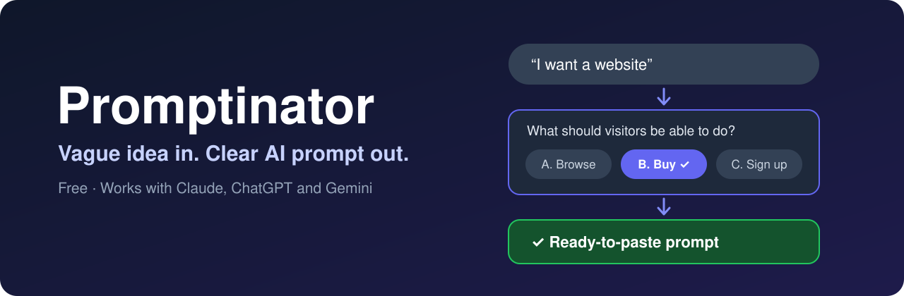

<div align="center">




**Stop giving AI vague requests.**<br>
Promptinator asks you a few quick questions, then hands you one clear prompt to paste into a new chat.

[**Get started ↓**](#pick-your-app) · [See an example](#before-and-after) · [Is it safe?](#safety)

</div>

## Why it works

- **AI is only as good as your request.** Most requests skip who it's for, what it must do and what "done" looks like.
- **Promptinator asks for exactly those**, one tap at a time, and suggests an answer for each.
- **It only writes the prompt.** It never does the work, so you start the real work in a clean new chat.

## Pick your app

| You use | Do this |
|---|---|
| Any AI chat | [Copy and paste it](#any-ai-chat-the-quickest-way) |
| ChatGPT or Gemini, often | [Save it in a Project, GPT or Gem](#chatgpt-or-gemini-keep-it-ready) |
| Claude | [Upload it as a skill](#claude-keep-it-as-a-skill) |
| Claude Code | [Run one command](#claude-code) |

## Before and after

**You type:**

```text
I want to create a website
```

**Promptinator asks short questions, one at a time:**

```text
Clear: 2 of 5 · Question 3

What should visitors be able to do on your website?

A. Browse and read
B. Buy things (suggested)
C. Sign up for something
D. You decide
E. Type my own
```

**After a few questions like that, you get a prompt you can copy:**

```text
You are helping me with: an online shop for handmade art

## Goal
Let artists sell their work and let customers buy it online.

## Who it is for
Art buyers and independent artists.

## Must-haves
- Customer and seller accounts with two-step sign-in
- Secure online payments
- Dashboards for sellers and an admin area with access levels
- Trusted login and payment services, with no card details stored

## Done means
- I can sign up, buy a test item and see it in my orders

## How to work
Before you start, give me your plan in a few lines and ask about anything that would change the result. Do not add things I did not ask for.
```

## How to use it

### Any AI chat: the quickest way

1. Open [PASTE-THIS.md](https://github.com/schuligan/promptinator/blob/main/PASTE-THIS.md) and select the **Copy raw file** button at the top right of the file.
2. Paste it into a new chat in Claude, ChatGPT, Gemini or another AI.
3. Answer the questions.
4. Copy the final prompt into a new chat.

You type your answers here. Some apps may show clickable buttons, but not all do.

### ChatGPT or Gemini: keep it ready

Save it once so you don't have to paste it every time.

- **ChatGPT:** create a Project or a custom GPT and paste everything from [PASTE-THIS.md](https://github.com/schuligan/promptinator/blob/main/PASTE-THIS.md) into its instructions.
- **Gemini:** create a Gem and paste everything from [PASTE-THIS.md](https://github.com/schuligan/promptinator/blob/main/PASTE-THIS.md) into its instructions.

Then start a chat there and say what you want help with.

### Claude: keep it as a skill

1. [Download promptinator.zip](https://github.com/schuligan/promptinator/raw/main/promptinator.zip).
2. In Claude, turn on code execution in Settings > Capabilities. Claude needs this for all skills. Promptinator doesn't run any code.
3. Go to Customize > Skills, select **+**, choose **Create skill**, then **Upload a skill**.
4. In any chat, type: `Use Promptinator`

### Claude Code

```bash
mkdir -p ~/.claude/skills/promptinator
curl -fsSL https://raw.githubusercontent.com/schuligan/promptinator/main/promptinator/SKILL.md -o ~/.claude/skills/promptinator/SKILL.md
```

Then type `/promptinator`.

## Safety

- **Instructions only:** Promptinator is plain text. It has no code, scripts, tracking or setup that runs on your computer.
- **Nothing is sent by Promptinator:** it tells the AI not to use the web, your files or connected apps. Your answers still go to the AI service you're using, under that service's own terms.
- **Check it yourself:** always read a skill before installing it. [SKILL.md](https://github.com/schuligan/promptinator/blob/main/promptinator/SKILL.md) is short. `promptinator.zip` contains only that one file.
- **Protect your details:** don't paste passwords, API keys or card numbers into any AI chat.
- **Review the prompt:** AI can make mistakes, so read the final prompt before you use it. Anything it chose for you is listed under Assumptions.

## Questions

<details>
<summary><b>Is it free?</b></summary>

Yes. No account and no sign-up. It's MIT licensed.
</details>

<details>
<summary><b>Why doesn't it just do the task?</b></summary>

On purpose. A clear prompt in a fresh chat gets a better result than a long chat full of back-and-forth. You can also reuse the prompt in any AI.
</details>

<details>
<summary><b>Can I change the prompt it gives me?</b></summary>

Yes. Tell it what to change and it shows the whole prompt again.
</details>

<details>
<summary><b>Will it make images or video prompts?</b></summary>

Yes. For an image or video it writes one descriptive paragraph you can paste into your image or video tool.
</details>

## Licence

[MIT](https://github.com/schuligan/promptinator/blob/main/LICENSE). You can use it, change it and share it.
